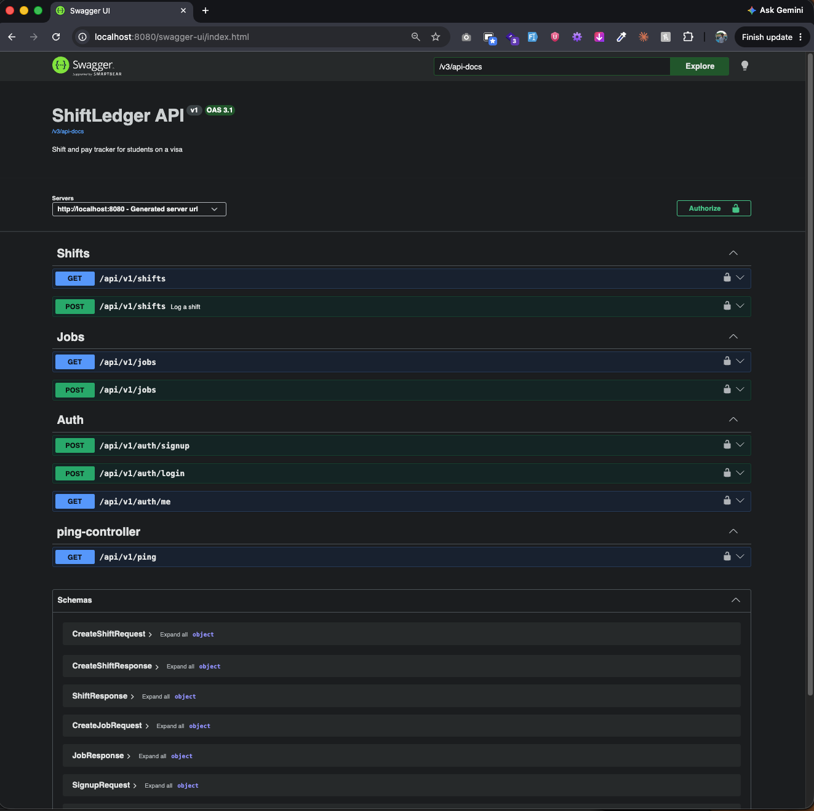
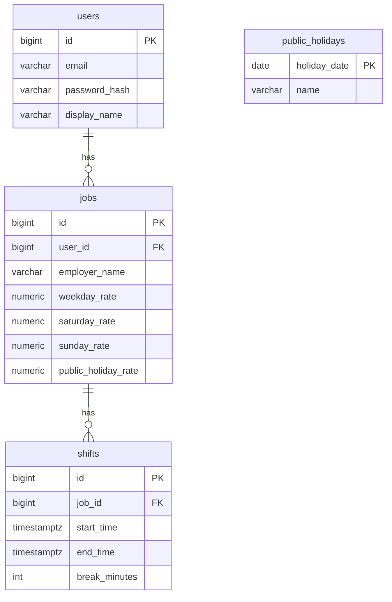

# ShiftLedger


**Live demo:** https://shiftledger-65u6.onrender.com/swagger-ui/index.html
(free hosting, so the first request after a quiet spell takes a minute or two to wake up)

I work casual shifts while studying in Adelaide on a student visa. Working out pay across
weekend and public holiday rates, and staying under the 48-hour fortnight limit, gets fiddly
fast. ShiftLedger is a REST API that does both.

**Stack:** Java 21, Spring Boot 4, Spring Security (JWT), PostgreSQL 17, Flyway, JPA/Hibernate,
JUnit 5, Testcontainers, Docker Compose, GitHub Actions, OpenAPI/Swagger



## What it does

- Sign up and log in (JWT, passwords hashed with BCrypt)
- Add jobs with their own weekday, Saturday, Sunday and public holiday rates
- Log shifts and get the pay worked out automatically
- Blocks overlapping shifts, even across different jobs
- Warns when a visa fortnight goes over 48 hours
- Everyone only ever sees their own data

## Run it locally

You need Java 21 and Docker.

```bash
git clone https://github.com/raichung/shiftledger.git
cd shiftledger
docker compose up -d
./mvnw spring-boot:run
```

Then open http://localhost:8080/swagger-ui.html to try every endpoint in the browser.

## Endpoints

| Method | Path | Login needed | What it does |
|---|---|---|---|
| POST | `/api/v1/auth/signup` | No | Create an account |
| POST | `/api/v1/auth/login` | No | Get a token (valid for 1 hour) |
| GET | `/api/v1/auth/me` | Yes | Who am I |
| POST | `/api/v1/jobs` | Yes | Add a job with its pay rates |
| GET | `/api/v1/jobs` | Yes | List my jobs |
| POST | `/api/v1/shifts` | Yes | Log a shift, returns pay and any warnings |
| GET | `/api/v1/shifts` | Yes | List my shifts with pay |

## Data model



## Design decisions

- **Money is `NUMERIC` / `BigDecimal`, never floating point.** Pay is rounded once at the end so no cents go missing.
- **Times are stored in UTC and shown in Adelaide time.** Shifts are split at midnight local time, so Saturday night into Sunday gets both rates. Daylight saving changes are handled, and there's a test for it.
- **Public holidays live in a table**, loaded by a Flyway migration. Next year's dates are a new migration, not a code change.
- **The 48-hour rule:** a visa fortnight is 14 days starting on a Monday, so every day sits in two of them and both get checked. It only warns, because the limit doesn't apply during course breaks.
- **Everything is scoped to the logged-in user.** Asking for someone else's job returns 404, so it doesn't even reveal that the job exists.
- **Stateless auth.** Tokens are signed with HS256. The server keeps no sessions.

## Project structure

```
src/main/java/com/raichung/shiftledger
├── common/   security, docs config, current user
├── user/     sign up, login, tokens
├── job/      jobs and pay rates
├── shift/    shifts, overlap check, 48-hour warning
├── pay/      pay calculator
└── holiday/  public holidays
```

Code is grouped by feature, and each feature follows controller → service → repository.

## Tests

```bash
./mvnw verify
```

- Unit tests for the pay maths, including midnight crossovers, public holidays and daylight saving
- Integration tests that run the whole API against a real PostgreSQL in Docker (Testcontainers)
- GitHub Actions runs everything on every push and pull request

## Known limitations

- Christmas Eve and New Year's Eve part-day holidays (7pm to midnight) aren't handled yet
- A shift counts toward the fortnight it starts in
- One time zone (Adelaide) for everyone
- No refresh tokens yet, so you log in again after an hour
- The 48-hour check is a helper, not visa advice. Always check your own visa conditions.